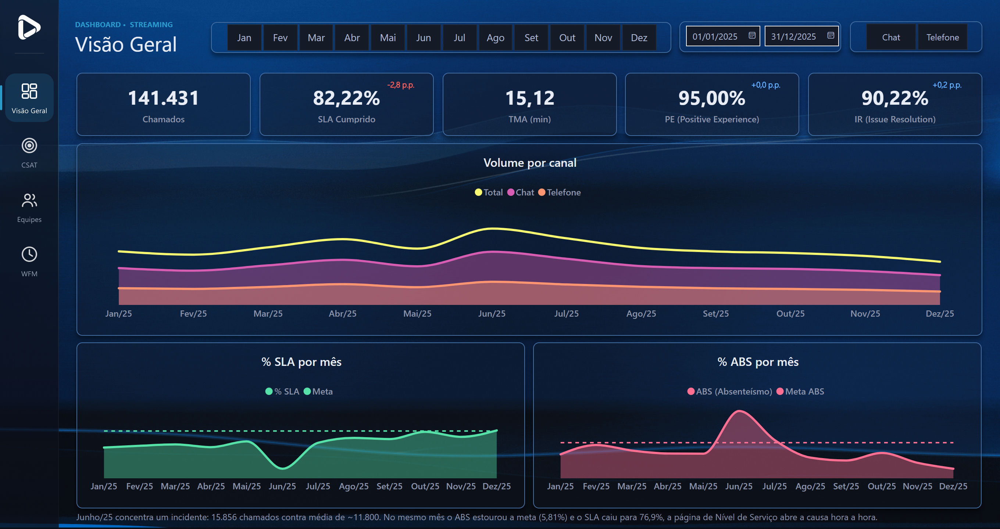
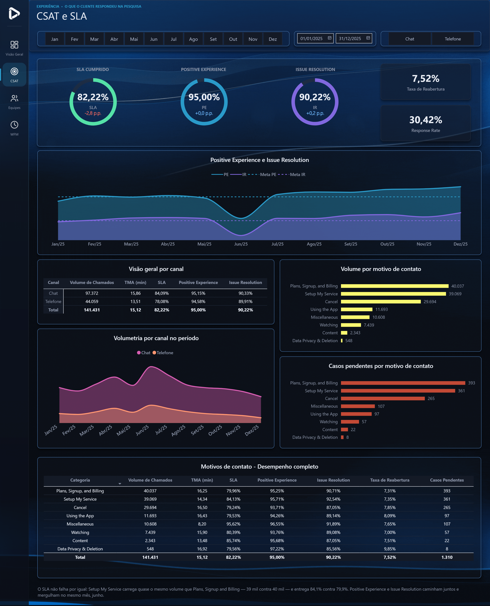
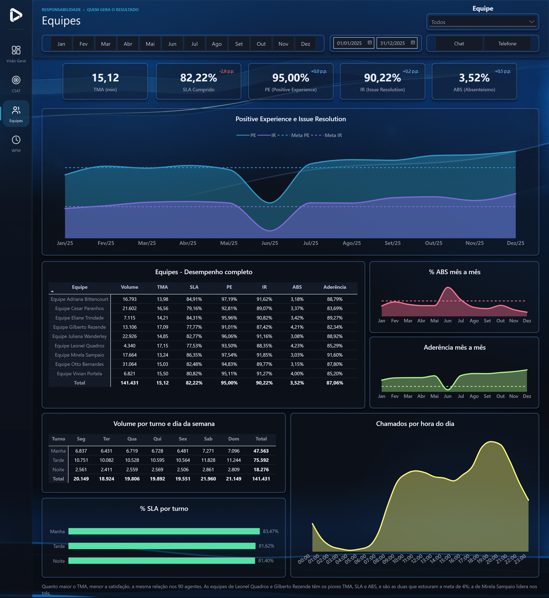
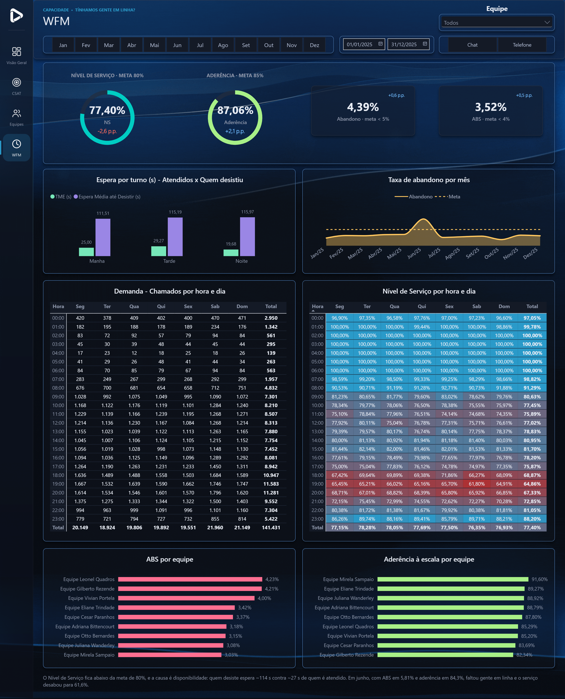

# Central de Atendimento · Dashboard Operacional (Power BI)

Um ano de operação de atendimento lido em quatro perguntas: **como foi o período**, **como o cliente viveu**, **quem entregou** e **se havia gente em linha para sustentar**.

**[▶ Abrir o dashboard interativo](https://app.powerbi.com/view?r=eyJrIjoiNmZmZTk1NDAtNzIyNC00MTljLWE3ZmMtYzdlNTc3NGRmNDJiIiwidCI6ImJmYTcyOWViLWFhYTQtNDAyYS1iYzY0LWE1MzlkNGI5NTY1NyJ9&pageName=305de39e52d0493bf5d9)** · [Fechamento 2025 (apresentação)](fechamento-2025.html) · [Consultas SQL](sql/)



> Base 100% fictícia (141.431 chamados em 2025), desenhada a partir dos KPIs reais de uma operação de atendimento de streaming. Projeto autoral de portfólio.

## O problema

Em operação de atendimento, os números chegam separados: volume num relatório, SLA em outro, pesquisa de satisfação num terceiro e escala numa planilha do WFM. Quando o SLA cai, cada área defende o seu pedaço. Este dashboard junta tudo num modelo só, para a liderança ver **sintoma e causa na mesma tela**.

## O insight

Junho teve **15.856 chamados, 35% acima da média do ano**. No mesmo mês, o **absenteísmo passou da meta de 4% (5,81%)** e o **SLA caiu para 76,9%**. Nenhum número, sozinho, explica o problema; lidos juntos, contam a história: demanda alta com equipe desfalcada. O mapa de calor da página WFM mostra o horário mais frágil: das 18h às 20h.

## As páginas

| Página | Pergunta | Destaques |
|---|---|---|
| Visão Geral | Como foi o período? | 5 KPIs com variação em p.p. vs mês anterior, volume por canal, SLA e ABS mês a mês |
| CSAT e SLA | Como o cliente viveu? | Positive Experience e Issue Resolution vs metas, motivos de contato, reabertura, backlog |
| Equipes | Quem entregou o resultado? | Desempenho por equipe, turno e hora, na mesma régua de KPIs |
| WFM | Tínhamos gente em linha? | Nível de serviço, aderência, abandono e mapas de calor de demanda × serviço |

<p>
  
  
  
</p>

## Modelagem

Modelo estrela com **3 tabelas fato**, cada uma no seu grão, e **6 dimensões** compartilhadas:

- `Fato_Chamados` (um chamado), `Fato_Abandonos` (um contato que desistiu da fila), `Fato_Escala` (um dia de escala de um agente)
- `Dim_Data`, `Dim_Hora`, `Dim_Canal`, `Dim_Agente`, `Dim_Cliente`, `Dim_Motivo_Contato`

Data e canal filtram as três fatos ao mesmo tempo, o que permite cruzar satisfação, fila e escala no mesmo visual. São ~50 medidas DAX organizadas em pastas e documentadas. Alguns exemplos:

```dax
-- Diferença em pontos percentuais (não variação relativa): é o que se lê num cartão de KPI
Var. SLA vs Mês Anterior (p.p.) =
IF ( NOT ISBLANK ( [% SLA Mês Anterior] ), [% SLA Cumprido] - [% SLA Mês Anterior] )

-- A meta vem da dimensão de canal e acompanha o filtro (chat 30 s, telefone 45 s, alvo de 80%)
Meta Nível de Serviço = DIVIDE ( AVERAGE ( Dim_Canal[Meta_Nivel_Servico_Pct] ), 100 )
```

## Como abrir

1. Clone o repositório ou baixe o ZIP.
2. Abra `pbip/Dash Operacional.pbip` no Power BI Desktop.
3. Em **Transformar dados → Editar parâmetros**, aponte `Caminho_Base` para a pasta `dados/` na sua máquina.
4. Clique em **Atualizar**.

## Estrutura

```
pbip/        Projeto Power BI (formato PBIP: relatório + modelo semântico em texto)
dados/       Os 8 CSVs da base fictícia
sql/         O mesmo modelo em SQL (MySQL 8) e 7 consultas de negócio
imagens/     Prints das páginas e vídeo de uso
fechamento-2025.html   Apresentação de fechamento do ano gerada a partir do modelo
```

## Ferramentas

Power BI · DAX · Power Query · Modelagem dimensional · SQL · Claude Code

---

Felipe Principe · [LinkedIn](https://www.linkedin.com/in/felipe-principe-731b7116a/) · [GitHub](https://github.com/felipe-principe)
